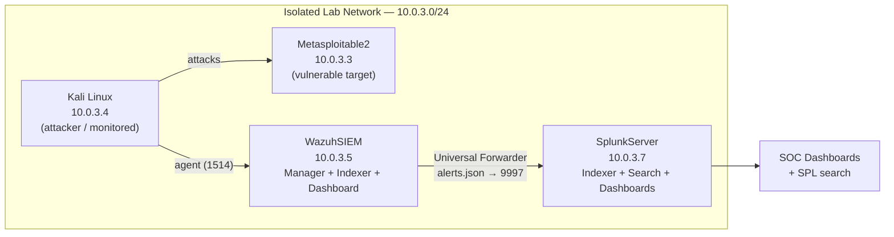

# Home SOC Lab — Wazuh SIEM + Splunk Detection & Monitoring Pipeline

A self-built Security Operations Center (SOC) lab that detects, forwards, and visualizes
host- and network-based attacks across an isolated virtual network. Built from scratch on a
single laptop using VirtualBox, it implements a realistic distributed detection pipeline:
**endpoints → Wazuh SIEM → Splunk analytics → dashboards**, with attacks generated from a
dedicated offensive VM.

This is **Project 2** in a cybersecurity portfolio, building on
[CyberLab Vulnerability Scanner](https://github.com/AdrianDownes673/cyberlab-vulnerability-scanner)
(Project 1), which it reuses in the planned AI-enrichment phase.

> **Status:** Phases 1–2 complete (detection + SIEM/analytics pipeline). Phases 3–5 (AI
> enrichment, incident workflow, NL query) planned. See [Roadmap](#roadmap).

---

## Table of Contents
- [What this project demonstrates](#what-this-project-demonstrates)
- [Architecture](#architecture)
- [Lab environment](#lab-environment)
- [Phase 1 — Detection with Wazuh](#phase-1--detection-with-wazuh)
- [Phase 2 — Analytics pipeline with Splunk](#phase-2--analytics-pipeline-with-splunk)
- [Engineering challenges solved](#engineering-challenges-solved)
- [Known limitations](#known-limitations)
- [Skills demonstrated](#skills-demonstrated)
- [Roadmap](#roadmap)

---

## What this project demonstrates

- **End-to-end detection engineering:** deploying a SIEM, writing custom detection rules,
  mapping alerts to MITRE ATT&CK, and tuning out noise.
- **A distributed log pipeline:** shipping structured alerts from a detection tier (Wazuh) to
  a separate analytics tier (Splunk) using a push-based forwarder — the pattern used in real
  enterprise environments.
- **Systems & network engineering under constraints:** Linux administration, VirtualBox
  networking, subnetting, and capacity planning on limited hardware.
- **A disciplined troubleshooting methodology:** diagnosing failures bottom-up (is *any* data
  flowing before blaming the rule?), verifying hypotheses with tests instead of assumptions,
  and knowing when to refactor the root cause versus patch the symptom.
- **Honest limitation reporting:** several hard problems are documented with their root-cause
  analysis rather than hidden — the way a real engineer tracks known gaps.

---

## Architecture

**Design decision — two tiers, two hosts.** Detection/collection (Wazuh) and
analytics/indexing (Splunk) run on **separate VMs**, mirroring a real distributed SIEM rather
than collapsing everything onto one box. Data moves via a **Splunk Universal Forwarder**
installed on the Wazuh host — a lightweight agent that tails `alerts.json` and pushes it to the
Splunk receiver on `:9997`. The push model keeps the collector at the data source (local file
access, local buffering on network blips) and avoids giving a central puller credentials into
every host.

---

## Lab environment

| VM | Role | OS | Lab IP |
|----|------|----|--------|
| **WazuhSIEM** | SIEM manager, indexer, dashboard; Splunk forwarder | Ubuntu Server 22.04 | 10.0.3.5 |
| **SplunkServer** | Splunk Enterprise indexer / search head | Ubuntu Server 22.04 | 10.0.3.7 |
| **Kali Linux** | Attacker + monitored endpoint (Wazuh agent) | Kali Rolling | 10.0.3.4 |
| **Metasploitable2** | Intentionally vulnerable target | Ubuntu 8.04 (2012) | 10.0.3.3 |

- **Host:** ASUS Zenbook 14, 16 GB RAM, Windows 11, VirtualBox.
- **Network:** a dedicated, isolated `10.0.3.0/24` NAT Network for lab traffic, with each VM
  also holding a NAT adapter for internet/host access. Static addressing for stable,
  documentable topology.
- **Host access:** per-VM SSH and web UIs via VirtualBox port-forwards (e.g. Splunk Web on
  `127.0.0.1:8000`, forwarder host SSH on dedicated ports).

---

## Phase 1 — Detection with Wazuh

Deployed a full single-node **Wazuh** stack (manager + indexer + dashboard) and enrolled agents
on the monitored endpoints.

**Implemented:**
- **Agent-based monitoring** on Kali, reporting system, authentication, and file-integrity
  events to the manager.
- **Correlation detection:** demonstrated Wazuh's rule engine escalating individual
  low-severity events into a higher-severity correlated alert (e.g. repeated failed `sudo`
  invocations → a level-10 "multiple failed attempts" alert) — showing understanding of
  event correlation vs. single-event matching.
- **Custom detection rule (`local_rules.xml`, rule 100002, level 12):** a bespoke rule
  designed to detect lateral movement — a monitored host opening a connection to the
  **vsftpd 2.3.4 backdoor port (6200)** on the unmonitored legacy target. Backed by a
  persistent `auditd` rule capturing outbound `connect()` syscalls.
- **MITRE ATT&CK mapping:** verified alerts carry technique IDs (e.g. **T1548.003** Sudo and
  Sudo Caching, **T1136** Create Account) for framework-aligned triage.
- **Threat validation:** manually reproduced the vsftpd backdoor exploit end to end (raw FTP
  trigger → root shell on port 6200), and confirmed the resulting connection in Wazuh's
  inventory data.

**Detection narrative:** because the legacy target cannot run a modern agent (see
[Known limitations](#known-limitations)), attacks against it are framed as **lateral movement
from a monitored device to an unmonitored legacy device** — a realistic and common enterprise
detection-gap scenario, not a workaround.

---

## Phase 2 — Analytics pipeline with Splunk

Stood up **Splunk Enterprise** on a dedicated VM and connected it to Wazuh with a
**Universal Forwarder**, producing a working end-to-end pipeline.

**Implemented:**
- **Splunk Enterprise** installed and run under a **dedicated non-root service account**
  (least privilege), managed by systemd with boot-start, receiving on port `9997`.
- **Universal Forwarder** on the Wazuh host, also running **non-root** and granted read access
  to Wazuh's logs via **group membership** (added to the `wazuh` group) rather than loosening
  file permissions or running as root.
- **Structured ingestion:** forwards `/var/ossec/logs/alerts/alerts.json` with
  `sourcetype=wazuh_alerts`; Splunk auto-extracts the JSON fields (`rule.level`,
  `rule.description`, `agent.name`, `data.*`, MITRE fields) into searchable fields.
- **SPL analysis** reflecting real SOC workflows:
  - Triage by severity — `sourcetype=wazuh_alerts rule.level>=10`
  - Noise/tuning analysis — `... | stats count by rule.description | sort -count`
  - Per-host outliers — `... | stats count by agent.name`
  - Trend/spike detection — `... | timechart count`
- **SOC overview dashboard** with panels for top alert rules, alerts by host, and alert volume
  over time.
- **Live detection demo:** simulated an attacker persistence technique (**T1136 – Create
  Account**, `useradd`) and watched the alert flow all the way from the endpoint into a Splunk
  search in seconds — proving the full pipeline on a security-meaningful event.

---

## Engineering challenges solved

These are the problems that make up the real work — each was diagnosed, resolved, and (where
relevant) made permanent.

- **Subnet-overlap routing / ARP flux (root-cause refactor).** The lab initially shared the
  `10.0.2.0/24` range with VirtualBox's NAT adapter. Once two VMs became dual-homed on the
  overlapping subnet, traffic between them failed with asymmetric ARP behavior. Rather than
  keep patching it with per-host `/32` static routes, I **re-segmented the entire lab onto a
  dedicated `10.0.3.0/24` subnet**, eliminating the overlap at the root — which removed the
  need for the static routes and ARP tuning entirely. *(Recognizing accumulating technical debt
  and refactoring to a clean design.)*
- **Modern logging pipeline mismatch.** Current Kali logs authentication events to
  `journald` only, and Wazuh's journald reader wasn't forwarding the relevant events. Diagnosed
  bottom-up, then installed `rsyslog` to restore `/var/log/auth.log` and pointed Wazuh at it —
  a reliable text-file collection path.
- **LVM capacity planning.** Caught Ubuntu's installer allocating only half the disk to the
  logical volume and corrected it during install (and recovered a running system from a full
  disk by extending the LV) — avoiding a recurring out-of-space failure.
- **Disk exhaustion from the vulnerability feed.** Traced a 100%-full disk to Wazuh's
  vulnerability-detection database (~19 GB), disabled the module for the lab, and reclaimed the
  space — documented as a storage-constraint trade-off.
- **Persistent network configuration.** Converted fragile, session-only `ip route` commands
  into declarative, reboot-surviving **netplan** configuration (later retired by the
  re-segmentation above).
- **Capacity right-sizing.** Observed Splunk exhausting memory on a 3 GB VM (thrashing the host
  unresponsive) and identified the fix — raising the VM to Splunk's supported ≥4 GB — a concrete
  capacity-planning lesson.
- **Legacy package-management recovery.** Repaired broken `dpkg` maintainer-script state and
  resolved `apt` lock contention from `unattended-upgrades` (and disabled the auto-upgrade
  timers to stop them interfering with lab sessions).

---

## Known limitations

Documented honestly — these reflect real tooling edges and deliberate scoping decisions.

- **Custom backdoor rule — live auto-alerting (open).** Rule 100002 is **proven correct**
  (fires on the real event in `wazuh-logtest`), but live auto-alerting is blocked by a
  two-layer Wazuh audit-integration issue:
  1. *Multi-line audit reassembly (solved):* a network `connect()` produces a multi-record
     audit event that arrived at the manager mangled over raw-file tailing. Fixed by routing
     audit events through the **`audisp-syslog`** dispatcher, which emits clean single-line
     events.
  2. *Decoder-format mismatch (open):* delivered via syslog, the events are pre-decoded as
     syslog and never reach Wazuh's audit decoder. The remaining fix is a **custom decoder** —
     a scoped, understood future enhancement. The connection is independently verifiable via
     Wazuh's inventory data in the meantime.
- **Legacy target can't run a modern agent.** Metasploitable2 (2012, i386) fails to start the
  current Wazuh agent due to a `GLIBCXX`/`libstdc++` incompatibility — a hard architectural
  limit. Documented and reframed as the lateral-movement detection scenario above.
- **Correlated sudo-brute-force alerting is unreliable live.** The individual failures log
  correctly, but the frequency-correlation rule does not consistently fire end-to-end in this
  environment; single-event detections (e.g. account creation) are used for reliable
  demonstrations instead.

> These are tracked the way a working engineer tracks a backlog: root cause understood, fix
> path identified, impact bounded.

---

## Skills demonstrated

**Security:** SIEM deployment & administration (Wazuh), detection engineering & custom rules,
MITRE ATT&CK mapping, log pipeline architecture, alert triage & tuning, least-privilege service
design, offensive validation (exploit reproduction, lateral-movement modeling).

**Platforms & tooling:** Splunk (install, forwarders, SPL, dashboards), `auditd`/`audisp`,
`rsyslog`/`journald`, Linux administration, VirtualBox, systemd.

**Systems & networking:** subnetting & network segmentation, static routing, NAT, LVM/storage,
capacity planning, declarative config (netplan).

**Engineering practice:** bottom-up troubleshooting, hypothesis testing, root-cause refactoring
vs. patching, honest documentation.

---

## Roadmap

The remaining phases are scoped intentionally lean — minimal but defensible — to complete the
SOC story before moving on to cloud security (AWS/Terraform).

- **Phase 3 — AI alert enrichment.** A Python script that takes a Wazuh alert, calls an LLM
  (GPT-4o) to add MITRE ATT&CK context, a plain-language severity assessment, and a recommended
  analyst response — reusing the enrichment pipeline from
  [Project 1](https://github.com/AdrianDownes673/cyberlab-vulnerability-scanner).
- **Phase 4 — Incident workflow.** A lightweight case/ticketing step (via Splunk's native
  alerting actions or scripted case creation) rather than a heavyweight platform — demonstrating
  the response workflow without the infrastructure overhead.
- **Phase 5 — Natural-language querying.** A small interface that turns plain-English questions
  into SPL and runs them against Splunk's API.

---

## Screenshots

---

*Built and documented by Adrian Downes — B.Sc. Electrical & Computer Engineering, UWI St.
Augustine. Part of a cybersecurity portfolio toward a cloud security engineering role.*
